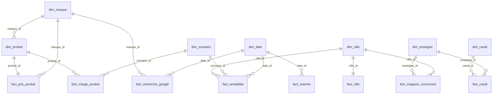

# 💄 Stratégie d'Expansion Européenne 2027-2029 : Implantation de Sephora aux Pays-Bas

> **Problématique Comex :** L'implantation de Sephora (maquillage) aux Pays-Bas est-elle réalisable et rentable ?
>
> **Réponse : NO-GO** pour un magasin 100 % maquillage en rue prime. **Réalisable : oui. Rentable : non** (0 combinaison ville × scénario rentable en 2029).

---

## Sommaire

1. [Présentation de l'Entreprise & de l'Équipe](#1-présentation-de-lentreprise--de-léquipe)
2. [Résultats & Décision](#2-résultats--décision)
3. [Cadrage & KPIs](#3-cadrage--kpis)
4. [Architecture des Données](#4-architecture-des-données)
5. [Dictionnaire des Données (Couche Gold)](#5-dictionnaire-des-données-couche-gold)
6. [Sources de Données](#6-sources-de-données)
7. [Organisation du Dépôt](#7-organisation-du-dépôt)
8. [Plan d'Organisation & Roadmap](#8-plan-dorganisation--roadmap)
9. [Limites](#9-limites)
10. [Stack Technique Utilisée](#10-stack-technique-utilisée)

---

## 1. Présentation de l'Entreprise & de l'Équipe

### Périmètre d'activité

- **Entreprise :** **Sephora** (Groupe LVMH), leader de la distribution sélective de produits de beauté en France (**23 %** de part de marché de la beauté sélective en 2024, contre 14 % pour Nocibé).

- **Réseau France :** **~300 magasins physiques** et **2,68 Md€** de chiffre d'affaires (Sephora SAS, 2025).

- **Périmètre Produit étudié :** Catégorie **Makeup (Maquillage)** uniquement (segments *Teint*, *Yeux*, *Lèvres*), analysée sur un panel de **31 références** issues des best-sellers maquillage de `sephora.fr` (13 marques : marques tendance Gen Z / TikTok comme *Rhode, Rare Beauty, Fenty Beauty, Makeup by Mario, Haus Labs*, marques classiques et *Sephora Collection*).

- **Pays Européen Ciblé :** **Pays-Bas**, avec un focus opérationnel sur les **4 pôles urbains majeurs de la Randstad** : *Amsterdam*, *Rotterdam*, *Utrecht* et *La Haye*.

### Contexte Historique & Thèse Stratégique (2013 vs 2027)

- **Le constat de l'échec (2008-2013) :** Sephora avait tenté une première implantation aux Pays-Bas en 2008 (via des corners au sein des grands magasins V&D) avant de se retirer en 2013. À l'époque, l'enseigne proposait un catalogue de parfumerie classique identique à celui du duopole local (**Douglas** et **ICI PARIS XL**, filiale du groupe A.S. Watson), entraînant une guerre des prix défavorable.

- **L'opportunité 2027-2029 :** Le marché de la beauté a basculé vers les marques virales Gen Z / TikTok. Notre étude vérifie par les données si **l'exclusivité de ces références aux Pays-Bas** et leur forte **désirabilité** permettent aujourd'hui un retour rentable.

### Équipe Projet (Data Analytics)

| Membre | Rôle | Branches |
| :--- | :--- | :--- |
| **Ludivine Etou Apendi** — Membre 1 | Data Produits/Prix (scraping), marché NL, prévisions de rentabilité | `feature/scraping-pricing`, `feature/parts-de-marche-nl`, `feature/previsions` |
| **Ema Fernandes** — Membre 2 | Data Marché NL (Google Trends, villes, concurrents), situation actuelle de Sephora & Slides Comex | `feature/market-slides` |
| **Lamyaa Marzouq** — Membre 3 | Data Engineer : ETL, nettoyage (Silver), modèle en constellation (Gold), contrôles qualité | `feature/etl-star-ai` |
| **Sarah Ranganadane** — Membre 4 | Lead Documentation (`README.md`) & DataViz | `readme` |

---

## 2. Résultats & Décision

| Axe | KPI | Valeur |
| :--- | :--- | ---: |
| Réalisable | Taille du marché du maquillage aux Pays-Bas (2024) | **515 M€** |
| Réalisable | Croissance annuelle moyenne 2019-2024 | **+6,5 %/an** |
| Réalisable | Part de marché Douglas + ICI Paris XL (magasins physiques) | **21,4 %** |
| Réalisable | Indice de prix NL / France (produits partagés, base 100 = France) | **96,4** |
| Réalisable | Part de produits en exclusivité vérifiée | **54,8 %** |
| Réalisable | Évolution des recherches « sephora » aux Pays-Bas | **+46,3 %** |
| Réalisable | Score de désirabilité : exclusifs / partagés | **72,0 / 56,3** |
| Rentable | Marge brute moyenne par produit (scénario central) | **10,95 € (42,8 %)** |
| Rentable | Combinaisons ville × scénario rentables en 2029 | **0 sur 12** |
| Rentable | Meilleur résultat annuel 2029 (La Haye, optimiste) | **−231 005 €** |
| Rentable | Part de marché minimale nécessaire au point mort | **8,7 %** |

**Conclusion :** le marché, la demande et les exclusivités sont là (**réalisable**), mais le loyer en rue prime et le personnel rendent un magasin 100 % maquillage **non rentable** sur 2027-2029.

**Recommandations :**

1. **Changer de format :** pop-up ou magasin en centre commercial (loyer et équipe réduits).
2. **Élargir l'offre :** ajouter le soin, mais pas le parfum (terrain fort de Douglas et ICI PARIS XL).
3. **Combiner les deux** et recalculer le point mort avec ces nouveaux coûts.

---

## 3. Cadrage & KPIs

### Les 5 Axes Stratégiques & KPIs Retenus

1. **Marché & Potentiel :** Taille du marché du maquillage aux Pays-Bas (€), taux de croissance annuel, part de marché de Sephora en France vs parts de marché de Douglas et ICI PARIS XL aux Pays-Bas.

2. **Prix & Marges :** Indice Prix Relatif (*Sephora FR* vs *Douglas NL / ICI PARIS XL*) et **Marge Brute estimée** (TVA néerlandaise à **21 %** contre 20 % en France), selon 3 scénarios (Pessimiste / Central / Optimiste).

3. **Réseau & Implantation :** Densité des boutiques concurrentes et loyer prime au m² dans les 4 villes de la Randstad.

4. **Opérations & Logistique :** Distance et coût de transport depuis l'entrepôt central Sephora France (Saran, près d'Orléans) vers les Pays-Bas (0 % de droits de douane au sein du marché unique européen).

5. **Assortiment :** Répartition des sous-catégories Makeup (*Teint, Yeux, Lèvres*) et proportion du catalogue en exclusivité vérifiée.

### KPI Propriétaire : Le « Score de Désirabilité »

Afin d'éviter l'erreur de 2013, nous mesurons l'appétence réelle des consommateurs néerlandais via un score composite sur 100 :

$$\text{Score de Désirabilité} = (0.40 \times \text{Google Trends NL}) + (0.35 \times \text{Score Avis \& Notes FR}) + (0.25 \times \text{Bonus Exclusivité Vérifiée})$$

- **Google Trends NL :** score de la marque (0-100, 100 = marque la plus recherchée).
- **Score avis :** note sur 5 ramenée sur 100.
- **Bonus exclusivité :** 100 si le produit est introuvable chez Douglas et ICI PARIS XL, sinon 0.

---

## 4. Architecture des Données

### Architecture Médaillon (`Bronze` → `Silver` → `Gold`)

```text
Bronze   data/raw/                 fichiers bruts collectés (scraping, Google Trends, CBS, localisateurs…)
Silver   data/silver/              9 tables nettoyées
Gold     data/gold/                7 dimensions + 8 tables de faits
         data/gold/vues/           8 vues à plat pour Looker Studio (dont les KPI)
```

1. **Bronze (`/data/raw`) :** Fichiers bruts : prix et produits, Google Trends NL, villes, magasins concurrents, marché et canaux, situation actuelle de Sephora.

2. **Silver (`/data/silver`) :** Nettoyage en Python : noms de marques harmonisés entre Google Trends et les produits, doublons supprimés, symboles ® et ™ retirés, formats longs (1 ligne par observation), nombres stockés en nombres.

3. **Gold (`/data/gold`) :** Modélisation dimensionnelle en **schéma en constellation**.

Tout le code de nettoyage et de modélisation est dans un seul fichier : `scripts/etl_nettoyage_modele_etoile.py`. Le détail des corrections est documenté dans [`docs/etl.md`](docs/etl.md).

### Justification du Modèle en Constellation

Plutôt que de mélanger des données produits et des données géographiques dans une seule table hybride (ce qui créerait des produits cartésiens artificiels et fausserait les agrégations), nous avons conçu **8 tables de faits au grain strict** qui partagent **7 dimensions**. Un filtre (scénario, ville, marque…) agit ainsi sur plusieurs tables de faits à la fois.

Deux règles :

- **un grain par table de faits** (un produit, une ville, une marque × une semaine…) ;
- **jamais de croisement produit × ville** : produits et villes sont dans des tables de faits séparées, reliées par des dimensions partagées.

Un lien en flocon (`dim_produit → dim_marque`) évite de répéter les informations de la marque dans chaque produit.



### Contrôles Qualité

**62 contrôles**, exécutés à chaque lancement du script, tous OK :

- **Silver (20) :** unicité des clés, aucune note manquante, exclusivité cohérente avec l'absence de prix NL, 53 semaines × 8 marques dans Google Trends, parts de marché à 100 %, prévisions reliées aux produits et aux villes.
- **Gold (42) :** clés uniques des 7 dimensions, aucune clé orpheline entre faits et dimensions, grain unique des 8 tables de faits, cohérence des calculs (résultat, marge, indice de prix, score entre 0 et 100).

---

## 5. Dictionnaire des Données (Couche Gold)

### 7 Dimensions

| Table | Clé | Lignes | Contenu |
| :--- | :--- | ---: | :--- |
| `dim_produit` | `produit_id` | 31 | Nom, marque, sous-catégorie (Teint, Yeux, Lèvres), type, rang sephora.fr, exclusif / partagé, LVMH, format mini |
| `dim_marque` | `marque_id` | 13 | Marque, groupe (LVMH, marque tendance, marque classique, marque maison Sephora), score Google Trends |
| `dim_ville` | `ville_id` | 4 | Ville, nom reconnu par les cartes, rue de référence du loyer |
| `dim_date` | `date_id` (AAAAMMJJ) | 62 | Date, année, trimestre, mois, semaine ISO |
| `dim_scenario` | `scenario_id` | 3 | Pessimiste / Central / Optimiste et leurs hypothèses (part de marché visée, marge, effectif, charges, transport, surface, salaire) |
| `dim_enseigne` | `enseigne_id` | 4 | Sephora, Douglas, ICI Paris XL, De Bijenkorf |
| `dim_canal` | `canal_id` | 7 | Canal de distribution, magasin physique ou non |

### 8 Tables de Faits

| Table | Grain | Lignes | Mesures principales |
| :--- | :--- | ---: | :--- |
| `fact_prix_produit` | 1 produit | 31 | Prix FR TTC/HT, prix Douglas et ICI Paris XL, indice de prix NL/FR, note, avis, score de désirabilité |
| `fact_marge_produit` | 1 produit × 1 scénario | 93 | Coût d'achat, marge brute (€), taux de marge (%) |
| `fact_recherche_google` | 1 marque × 1 semaine | 424 | Score Google Trends, semaine du pic |
| `fact_ville` | 1 ville | 4 | Population, marché local du maquillage, concurrents, loyers, distances |
| `fact_magasin_concurrent` | 1 magasin | 130 | Enseigne, ville, GPS, ville cible ou non |
| `fact_rentabilite` | 1 ville × 1 scénario × 1 année | 36 | CA, marge, loyer, personnel, transport, résultat annuel et cumulé, point mort |
| `fact_marche` | 1 année × 1 périmètre | 8 | Taille du marché (M€), croissance annuelle |
| `fact_canal` | 1 canal × 1 enseigne | 8 | Ventes (M€), parts de marché |

### 8 Vues pour le Dashboard (Looker Studio)

| Vue | Sert à |
| :--- | :--- |
| `vue_kpi` | Cartes de KPI (13 KPI calculés) |
| `vue_parts_de_marche` | Camembert des parts de marché |
| `vue_magasins_concurrents` | Concurrents par ville, carte |
| `vue_villes` | Comparaison des 4 villes |
| `vue_produits` | Prix, indice de prix, exclusivités, désirabilité |
| `vue_recherches_google` | Courbes de recherche Google |
| `vue_rentabilite` | Rentabilité par ville et par scénario |
| `vue_marges` | Marges par produit |

### Principaux Calculs

```text
indice_prix_nl_fr_ttc  = prix concurrent NL minimum TTC / prix Sephora FR TTC × 100   (produits partagés)
loyer_annuel_eur       = loyer prime au m² × 270 m²
resultat_annuel_eur    = marge brute − loyer − personnel − transport
```

---

## 6. Sources de Données

| Donnée | Source |
| :--- | :--- |
| Prix, notes, avis, exclusivité | Relevés `sephora.fr`, `douglas.nl`, `iciparisxl.nl` (scripts de collecte, 12/11/2026) |
| Recherches | Google Trends Pays-Bas, 01/11/2025 – 12/11/2026 |
| Population des villes | CBS StatLine (1er janvier 2026) |
| Loyers prime | NOS (Amsterdam, Rotterdam, Utrecht) ; Cushman & Wakefield (La Haye) |
| Magasins concurrents | Localisateurs `douglas.nl` (111 magasins) et `iciparisxl.nl` (19 magasins dans les villes cibles) |
| Distances | Google Maps depuis l'entrepôt Sephora de Saran |
| Marché et canaux | NCV via Beauty-Pro.nl (détail dans `docs/marche/`) |
| Situation actuelle de Sephora | LSA / Joko (parts de marché), Xerfi et Pappers (chiffre d'affaires), LVMH (résultats annuels) — détail dans `data/raw/sephora/sephora_situation_actuelle.csv` |

Chaque fichier brut indique sa source ; les sources du Membre 2 sont détaillées dans `data/raw/SOURCES_MEMBRE2.md`.

---

## 7. Organisation du Dépôt

```text
├── README.md                       ce fichier
├── data/
│   ├── raw/                        Bronze : fichiers bruts (produits, Trends, villes, concurrents, marché, Sephora)
│   ├── previsions/                 prix de vente, marges et rentabilité prévisionnels 2027-2029
│   ├── silver/                     9 tables nettoyées
│   └── gold/                       7 dimensions, 8 tables de faits
│       └── vues/                   8 vues pour Looker Studio
├── scripts/
│   ├── collecte/                   scraping sephora.fr et enrichissement des produits
│   └── etl_nettoyage_modele_etoile.py   nettoyage, modèle et contrôles qualité
└── docs/
    ├── etl.md                      documentation détaillée du nettoyage et du modèle
    ├── marche/                     étude des parts de marché Douglas / ICI Paris XL
    └── previsions/                 hypothèses des marges et de la rentabilité
```

---

## 8. Plan d'Organisation & Roadmap

### Méthodologie de Travail

Nous appliquons le cycle **PACE** (*Plan, Analyze, Construct, Execute*) couplé à un workflow **Git Feature Branch** : chaque membre développe sur sa branche dédiée (`feature/*`), puis fusionne sur `main` par pull request.

### Roadmap d'Exécution

- **Phase 1 — Plan & Cadrage :** Définition des 5W, sélection des produits Makeup et des 4 villes Randstad, initialisation du dépôt Git.

- **Phase 2 — Collecte & Nettoyage (Bronze → Silver) :** Scraping des prix et de la concurrence, Google Trends NL, données villes et marché, situation actuelle de Sephora.

- **Phase 3 — Modélisation Gold & DataViz :** Génération des 7 dimensions, 8 tables de faits et 8 vues, création du dashboard décisionnel dans Looker Studio.

- **Phase 4 — Arbitrage & Restitution Comex :** Synthèse stratégique Go/No-Go et soutenance orale de 10 minutes.

### Next Steps (Recommandations Post-Étude)

1. **Chiffrer un format plus léger en 2027 :** pop-up ou magasin en centre commercial, avec un loyer et une équipe réduits.
2. **Tester une offre maquillage + soin :** vérifier si l'ajout du soin permet d'atteindre le point mort.
3. **Recalculer la rentabilité** avec ces nouveaux coûts et ce nouveau chiffre d'affaires avant toute décision d'ouverture.

---

## 9. Limites

- **Loyers :** loyer de la rue la plus chère (« prime »), pas un loyer moyen ; sources de dates différentes.
- **Google Trends :** scores relatifs (0-100 dans une même requête), pas des volumes de recherche.
- **Score de désirabilité :** calculé pour 16 produits sur 31 ; les marques non suivies dans Google Trends n'ont pas de score (aucune valeur inventée).
- **Couverture des magasins :** Douglas sur tout le pays, ICI Paris XL sur les 4 villes cibles seulement.
- **Parts de marché par canal :** année 2020 (dernière répartition publiée) ; parts Douglas et ICI Paris XL estimées.
- **Part de marché de Sephora en France :** estimation issue d'un panel d'achats de consommateurs.

---

## 10. Stack Technique Utilisée

- **Collecte & Exploration :** Python (scraping), Google Trends, CBS StatLine, NOS, Cushman & Wakefield, Google Maps, localisateurs de magasins.

- **ETL, Nettoyage & Modélisation :** Python (`pandas`) — architecture Médaillon (`Bronze` / `Silver` / `Gold`), 62 contrôles qualité.

- **Data Visualisation :** Google Sheets + Looker Studio (dashboard décisionnel interactif).

- **Versioning & Collaboration :** Git & GitHub (branches `feature/*`, pull requests vers `main`).
