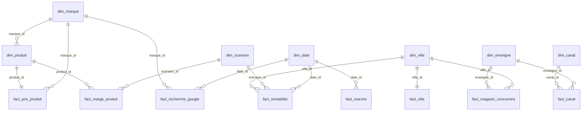

# rendu-groupe4-sephora-pays-bas — `feature/etl-star-ai`

> **Problématique :** l'implantation de Sephora (catégorie maquillage) aux Pays-Bas est-elle réalisable et rentable ?
> **Rôle :** Membre 3 — Lamyaa Marzouq, Data Engineer — ETL et modèle en étoile.

Cette branche contient la chaîne de traitement de la donnée, des fichiers bruts jusqu'aux tables du dashboard : **nettoyage** (couche Silver) puis **modèle en étoile** (couche Gold). Tout le code est dans un seul fichier : `scripts/etl_nettoyage_modele_etoile.py`.

## Sommaire

1. [Organisation](#1-organisation)
2. [Exécuter le code](#2-exécuter-le-code)
3. [Nettoyage des données (Silver)](#3-nettoyage-des-données-silver)
4. [Modèle en étoile (Gold)](#4-modèle-en-étoile-gold)
5. [Tables utilisées par le dashboard](#5-tables-utilisées-par-le-dashboard)
6. [KPI](#6-kpi)
7. [Contrôles de qualité](#7-contrôles-de-qualité)
8. [Sources](#8-sources)
9. [Limites](#9-limites)

---

## 1. Organisation

```text
 Bronze   data/raw/ + data/previsions/    fichiers bruts (8 fichiers)
    │
    │  ÉTAPE 1 : nettoyage           nettoyer_silver()
    ▼
 Silver   data/silver/                    9 tables nettoyées
    │
    │  ÉTAPE 2 : modèle en étoile    construire_gold()
    ▼
 Gold     data/gold/                      7 dimensions + 8 tables de faits
          data/gold/vues/                 8 vues à plat pour le dashboard (dont les KPI)
```

```text
.
├── scripts/etl_nettoyage_modele_etoile.py   code du nettoyage et du modèle en étoile
├── data/
│   ├── raw/          concurrents/, google_trends/, marche/, villes/, products_prices.csv
│   ├── previsions/   prix_vente_nl.csv, marges_nl.csv, rentabilite_villes_nl.csv
│   ├── silver/       tables nettoyées
│   └── gold/         dimensions, tables de faits, vues/
```

Seules les tables qui servent à l'analyse (dashboard et KPI) sont dans `data/`.

## 2. Exécuter le code

```bash
pip install pandas
python scripts/etl_nettoyage_modele_etoile.py            # nettoyage puis modèle
python scripts/etl_nettoyage_modele_etoile.py silver     # nettoyage seul
python scripts/etl_nettoyage_modele_etoile.py gold       # modèle seul
```

Le script affiche le journal des corrections, le volume de chaque table, les KPI et le résultat des contrôles. Il est déterministe : relancé, il réécrit exactement les mêmes fichiers. Il s'arrête en erreur si un contrôle échoue.

## 3. Nettoyage des données (Silver)

### Principes

- **Les clés de jointure sont des identifiants** (`product_id`, `city_id`, `store_id`), jamais des noms : La Haye s'appelle aussi Den Haag ou 's-Gravenhage selon les sources.
- **Les noms de marques sont harmonisés** entre Google Trends et les produits, pour pouvoir relier les tables.
- **Aucune valeur n'est inventée** : une donnée absente reste vide ; un produit sans note est retiré plutôt que complété.
- **Formats exploitables** : une ligne par observation (format long), nombres stockés en nombres, durées en minutes.

### Tables nettoyées

| Table | Lignes | Contenu | Fichier brut |
|---|---:|---|---|
| `produits_prix.csv` | 31 | Produits maquillage : prix France, prix Douglas / ICI Paris XL, notes, avis, exclusivité | `raw/products_prices.csv` |
| `google_trends_long.csv` | 424 | Recherches Google aux Pays-Bas, 1 ligne par semaine × marque (53 × 8) | `raw/google_trends/google_trends_nl.csv` |
| `villes_nl.csv` | 4 | Villes cibles : population, loyer prime, concurrents, distances | `raw/villes/market_cities_nl.csv` |
| `magasins_concurrents.csv` | 130 | Magasins Douglas (111) et ICI Paris XL (19) | `raw/concurrents/*.csv` |
| `marche_maquillage.csv` | 8 | Taille et croissance du marché du maquillage NL | `raw/marche/marche_maquillage_nl.csv` |
| `parts_de_marche_canaux.csv` | 8 | Ventes et parts de marché par canal | `raw/marche/parts_de_marche_canaux_nl.csv` |
| `prix_vente_nl.csv` | 31 | Prix de vente prévisionnels de Sephora aux Pays-Bas | `previsions/prix_vente_nl.csv` |
| `marges_nl.csv` | 93 | Marge brute prévisionnelle, 1 ligne par produit × scénario | `previsions/marges_nl.csv` |
| `rentabilite_villes.csv` | 36 | Rentabilité prévisionnelle par ville × scénario × année (2027-2029) | `previsions/rentabilite_villes_nl.csv` |

### Ce qui a été nettoyé

**`produits_prix.csv`**

| Anomalie | Traitement |
|---|---|
| P04 (Liquid Matte Mousse, Huda Beauty) : 0 avis, note absente | Produit retiré (32 → 31 lignes) |
| Noms en majuscules : `GLOSS BALM`, `LIP TINT FELT LINER`, `12H COLORFUL`… | Casse harmonisée (13 noms) |
| Symboles ® et ™ : `SoftSculpt®`, `Shape tape™`, `Master Mattes®`… | Supprimés |
| P14 : type de produit dans le nom, teinte dans la colonne type | Nom `HD Skin Face Essentials`, type `Palette teint`, teinte dans la nouvelle colonne `variant` |
| P17 : nom trop vague (`SoftSculpt`) | `SoftSculpt Sérum Bronzant` |
| P22 : nom incomplet (`12H COLORFUL`) | `12H Colorful Crayon Yeux` |
| P29 : type en majuscules | `Waterproof crayon yeux` |
| P06 : faute de frappe du site source (`brilliance`) | `Gloss haute brillance` |
| Commentaires sans accents (P26, P31, P32) | Accents rétablis |
| Rang et nombre d'avis stockés en décimal (`7.0`) | Convertis en entiers |
| Information manquante pour l'analyse | Ajout de `in_top10_sephora_fr` (0 pour les 2 produits Rhode ajoutés hors top 10) et `is_mini_format` (1 pour P26, prix d'un format mini) |

**`google_trends_long.csv`**

| Anomalie | Traitement |
|---|---|
| Format large (1 colonne par marque), impossible à relier aux autres tables | Format long : `semaine`, `marque`, `score_trends` |
| Semaine du 26/10/2025, avant la période d'étude | Retirée (période : 02/11/2025 → 01/11/2026, 53 semaines) |
| Noms différents des produits : `HUDA BEAUTY`, `rhode`, `makeup by mario`, `sephora` | Harmonisés : `Huda Beauty`, `Rhode`, `Makeup By Mario`, `Sephora` |
| « sephora » désigne l'enseigne, pas la marque Sephora Collection | Colonne `is_enseigne = 1` pour ne pas les confondre |
| Pic simultané de toutes les marques le 30/08/2026 | **Conservé** : pic réel, pas une erreur. Le retirer fausserait les moyennes |

**`villes_nl.csv`**

| Anomalie | Traitement |
|---|---|
| Colonnes de texte (sources, commentaire) mêlées aux chiffres | Retirées de la table ; sources reportées en [section 8](#8-sources) |
| Durée de trajet en texte (`7h04`) | `duree_route_saran_min` en minutes |
| Distance depuis Bruxelles estimée, non relevée | Colonne `distance_bruxelles_estimee = 1` |
| `nb_concurrents_total` inclut De Bijenkorf, absent de la liste des magasins | Ajout de `nb_douglas_ici` (Douglas + ICI Paris XL), comparable à `magasins_concurrents` |
| Tranche d'âge | Nom `15_44` conservé : les données CBS portent sur les 15-44 ans |

**`magasins_concurrents.csv`**

| Anomalie | Traitement |
|---|---|
| Deux fichiers séparés (Douglas, ICI Paris XL) aux colonnes différentes | Réunis dans une seule table, avec une clé `store_id` |
| `Den Haag` (Douglas) et `La Haye` (ICI Paris XL) | Harmonisés en `La Haye` + `city_id` |
| Codes postaux au format variable (`1811 JG`, `1077JH`) | Format unique `1234 AB` |
| ICI Paris XL sans coordonnées GPS | Colonne `has_gps` (0 pour ICI Paris XL) |
| Douglas couvre tout le pays, ICI Paris XL seulement les 4 villes | Colonne `is_ville_cible` (1 pour les 4 villes) |

**`marche_maquillage.csv` et `parts_de_marche_canaux.csv`** : aucune anomalie ; espaces supprimés, types numériques contrôlés, clé `canal_id` ajoutée aux canaux.

**Prévisions (`prix_vente_nl`, `marges_nl`, `rentabilite_villes`)**

| Anomalie | Traitement |
|---|---|
| P04 présent dans `prix_vente_nl` et `marges_nl` | Retiré, pour rester cohérent avec `produits_prix` |
| `marges_nl` en format large (1 colonne par scénario) | Format long (1 ligne par produit × scénario), pour partager la dimension scénario avec la rentabilité |
| Taux de marge de `rentabilite_villes` calculés avec P04 | Table conservée telle quelle : sans P04, les moyennes varient de moins de 0,1 point |

## 4. Modèle en étoile (Gold)

Le modèle est un **schéma en constellation** : plusieurs étoiles (une par table de faits) partagent les mêmes dimensions. Un filtre (scénario, ville, marque…) agit ainsi sur plusieurs tables de faits. Un lien en flocon (`dim_produit → dim_marque`) évite de répéter les informations de la marque dans chaque produit.

Deux règles :

- **un grain par table de faits** (un produit, une ville, une marque × une semaine…) ;
- **jamais de croisement produit × ville** : produits et villes sont dans des tables de faits séparées, reliées par des dimensions partagées.



### 7 dimensions

| Table | Clé | Lignes | Contenu |
|---|---|---:|---|
| `dim_produit` | `produit_id` | 31 | Nom, marque, sous-catégorie (Teint, Yeux, Lèvres), type, rang sephora.fr, exclusif / partagé, LVMH, format mini |
| `dim_marque` | `marque_id` | 13 | Marque, groupe (LVMH, Marque tendance, Marque classique, Marque maison Sephora, Enseigne étudiée), score Google Trends 0-100 |
| `dim_ville` | `ville_id` | 4 | Ville, `ville_geo` (nom reconnu par les cartes), rue de référence du loyer |
| `dim_date` | `date_id` (AAAAMMJJ) | 62 | Date, année, trimestre, mois, semaine ISO |
| `dim_scenario` | `scenario_id` | 3 | Pessimiste / Central / Optimiste et leurs hypothèses (part de marché visée, marge, effectif, charges, transport, ouverture, surface, salaire) |
| `dim_enseigne` | `enseigne_id` | 4 | Sephora, Douglas, ICI Paris XL, De Bijenkorf |
| `dim_canal` | `canal_id` | 7 | Canal de distribution, magasin physique ou non |

Les faits annuels (marché, rentabilité, canaux) sont reliés au 1er janvier de leur année (`date_id` = AAAA0101).

### 8 tables de faits

| Table | Grain | Lignes | Mesures principales |
|---|---|---:|---|
| `fact_prix_produit` | 1 produit | 31 | Prix FR TTC/HT, prix Douglas et ICI Paris XL, indice de prix NL/FR, prix Sephora NL, note, avis, score de désirabilité |
| `fact_marge_produit` | 1 produit × 1 scénario | 93 | Coût d'achat, marge brute (€), taux de marge (%) |
| `fact_recherche_google` | 1 marque × 1 semaine | 424 | Score Google Trends, semaine du pic, semaines d'ouverture des magasins Sephora en Belgique |
| `fact_ville` | 1 ville | 4 | Population, marché local du maquillage, concurrents, loyers, distances |
| `fact_magasin_concurrent` | 1 magasin | 130 | Enseigne, ville, GPS, ville cible ou non |
| `fact_rentabilite` | 1 ville × 1 scénario × 1 année | 36 | CA, marge, loyer, personnel, transport, résultat annuel et cumulé, point mort |
| `fact_marche` | 1 année × 1 périmètre | 8 | Taille du marché (M€), croissance annuelle |
| `fact_canal` | 1 canal × 1 enseigne | 8 | Ventes 2020 (M€), parts de marché |

### Calculs

```text
prix_sephora_fr_ht          = prix_sephora_fr_ttc / 1,20                        (TVA France 20 %)
prix_concurrent_nl_min_ttc  = minimum (prix Douglas, prix ICI Paris XL)
indice_prix_nl_fr_ttc       = prix_concurrent_nl_min_ttc / prix_sephora_fr_ttc × 100   (produits partagés)
indice_prix_nl_fr_ht        = (prix_concurrent_nl_min_ttc / 1,21) / prix_sephora_fr_ht × 100   (TVA NL 21 %)
loyer_annuel_270m2_eur      = loyer_prime_m2_an_eur × 270
couts_fixes_eur             = loyer + personnel + transport
resultat_annuel_eur         = marge brute − loyer − personnel − transport

Score de désirabilité = 0,40 × score Google Trends de la marque (0-100)
                      + 0,35 × score avis (note / 5 × 100)
                      + 0,25 × bonus exclusivité (100 si exclusif, sinon 0)
```

Échelle Google Trends : 100 = la marque la plus recherchée (Rhode). Le terme « sephora » mesure l'intérêt pour l'enseigne : il est exclu de l'échelle des marques et n'est pas attribué aux produits Sephora Collection.

## 5. Tables utilisées par le dashboard

Les vues à plat réunissent une table de faits et les libellés de ses dimensions : elles se branchent directement dans Looker Studio, sans jointure.

| Fichier | Sert à |
|---|---|
| `gold/vues/vue_kpi.csv` | Cartes de KPI (13 KPI calculés) |
| `gold/fact_marche.csv` | Courbe du marché du maquillage |
| `gold/vues/vue_parts_de_marche.csv` | Camembert des parts de marché |
| `gold/vues/vue_magasins_concurrents.csv` | Concurrents par ville, carte |
| `gold/vues/vue_villes.csv` | Comparaison des 4 villes |
| `gold/vues/vue_produits.csv` | Prix, indice de prix, exclusivités, désirabilité |
| `gold/vues/vue_recherches_google.csv` | Courbes de recherche Google |
| `gold/vues/vue_rentabilite.csv` | Rentabilité par ville et par scénario |
| `gold/vues/vue_marges.csv` | Marges par produit |

## 6. KPI

| Axe | KPI | Valeur |
|---|---|---:|
| Réalisable | Taille du marché du maquillage NL (2024) | 515 M€ |
| Réalisable | Croissance annuelle moyenne 2019-2024 | +6,5 %/an |
| Réalisable | Part de marché Douglas + ICI Paris XL (magasins physiques) | 21,4 % |
| Réalisable | Indice de prix NL / France (produits partagés) | 96,4 |
| Réalisable | Part de produits exclusifs | 54,8 % |
| Réalisable | Évolution des recherches « sephora » aux Pays-Bas | +46,3 % |
| Réalisable | Score de désirabilité : exclusifs / partagés | 72,0 / 56,3 |
| Rentable | Marge brute moyenne par produit (central) | 10,95 € (42,8 %) |
| Rentable | Combinaisons ville × scénario rentables en 2029 | 0 sur 12 |
| Rentable | Meilleur résultat annuel 2029 (La Haye, optimiste) | −231 005 € |
| Rentable | Part de marché minimale nécessaire au point mort | 8,7 % |

## 7. Contrôles de qualité

Exécutés à chaque lancement : **62 contrôles, tous OK**.

- **Silver (20)** : unicité des clés, P04 absent, aucune note manquante, exclusivité cohérente avec l'absence de prix NL, plus de ® ni ™, 53 semaines × 8 marques, 5 marques communes entre Trends et produits, nombre de magasins par ville identique à `villes_nl`, parts de marché à 100 %, prévisions reliées aux produits et aux villes, mêmes scénarios dans marges et rentabilité.
- **Gold (42)** : clés uniques des 7 dimensions, aucune clé orpheline entre faits et dimensions, grain unique des 8 tables de faits, cohérence des calculs (résultat, marge, indice de prix, score entre 0 et 100, échelle Trends à 100), cohérence entre tables (magasins par ville, parts de marché).

## 8. Sources

| Donnée | Source |
|---|---|
| Prix, notes, avis | sephora.fr, douglas.nl, iciparisxl.nl (relevés le 12/11/2026) |
| Recherches | Google Trends NL, 01/11/2025 – 12/11/2026 (`rhode` en marque Google pour exclure « Rhode Island ») |
| Population des villes | CBS StatLine 03759ned (1er janvier 2026) |
| Loyers prime | NOS, classement des rues les plus chères (Amsterdam, Rotterdam, Utrecht) ; Cushman & Wakefield nov. 2025 (La Haye) |
| Magasins concurrents | Localisateurs douglas.nl et iciparisxl.nl (12/11/2026) |
| Distances | Google Maps depuis l'entrepôt de Saran (12/11/2026) ; Bruxelles : estimation |
| Marché et canaux | NCV via Beauty-Pro.nl et sources détaillées dans `raw/marche/` |

## 9. Limites

- **De Bijenkorf** est compté dans `nb_concurrents_total` mais n'a pas de liste de magasins : pour comparer avec `fact_magasin_concurrent`, utiliser `nb_douglas_ici`.
- **Couverture des magasins** : Douglas sur tout le pays (avec GPS), ICI Paris XL sur les 4 villes cibles seulement (sans GPS). Filtrer sur `is_ville_cible = 1` pour comparer.
- **Loyers** : loyer de la rue la plus chère (« prime »), pas un loyer moyen ; sources de dates différentes.
- **Google Trends** : scores relatifs (0-100 dans une même requête), pas des volumes.
- **Score de désirabilité** : 16 produits sur 31. Les marques non suivies dans Google Trends (Sephora Collection, Too Faced, Tarte, Benefit Cosmetics, Make Up For Ever) n'ont pas de score ; aucune valeur n'est inventée.
- **Parts de marché par canal** : année 2020 (dernière répartition publiée) ; parts Douglas et ICI Paris XL estimées.
- **Séparateur décimal** : point (`4.6`). Dans Google Sheets, régler les paramètres régionaux sur « États-Unis » avant l'import.
