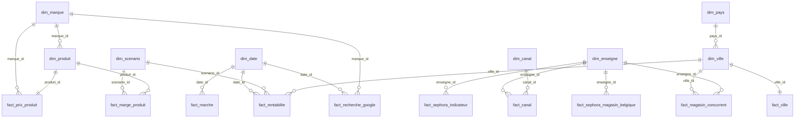

# rendu-groupe4-sephora-pays-bas — branche `feature/etl-star-ai`

> **Problématique :** l'implantation de Sephora (catégorie maquillage) aux Pays-Bas est-elle réalisable et rentable ?
> **Rôle de la branche (Membre 3 — Lamyaa Marzouq, Data Engineer) :** ETL complet et modèle en étoile.

La branche réunit les **tables nettoyées** (couche Silver, issues de `feature/silver`) et le **modèle en étoile** (couche Gold, issu de `feature/gold`), avec **un seul fichier Python** qui rejoue tout le traitement : `scripts/etl_nettoyage_modele_etoile.py`.

## Sommaire

1. [Contenu de la branche](#1-contenu-de-la-branche)
2. [Architecture médaillon](#2-architecture-médaillon)
3. [Code Python : nettoyage + modèle en étoile](#3-code-python--nettoyage--modèle-en-étoile)
4. [Couche Silver : tables nettoyées](#4-couche-silver--tables-nettoyées)
5. [Couche Gold : modèle en étoile (constellation)](#5-couche-gold--modèle-en-étoile-constellation)
6. [KPI obtenus](#6-kpi-obtenus)
7. [Contrôles de qualité](#7-contrôles-de-qualité)
8. [Dossier `autres/`](#8-dossier-autres)
9. [Limites](#9-limites)

---

## 1. Contenu de la branche

```text
.
├── README.md                              ← ce fichier
├── scripts/
│   └── etl_nettoyage_modele_etoile.py     ← nettoyage (Silver) + modèle en étoile (Gold), un seul fichier
├── data/
│   ├── raw/                               ← Bronze : fichiers bruts (entrées du nettoyage)
│   ├── previsions/                        ← Bronze : prévisions prix, marges, rentabilité (entrées du nettoyage)
│   ├── silver/                            ← 13 tables nettoyées + README détaillé des corrections
│   └── gold/                              ← 8 dimensions + 10 tables de faits + README du modèle
│       └── vues/                          ← 8 vues à plat pour le dashboard (dont vue_kpi.csv)
└── autres/                                ← anciennes tables et ancien modèle de la branche (remplacés)
```

| Dossier | Origine | Rôle |
|---|---|---|
| `data/raw/`, `data/previsions/` | `feature/gold` (identique à `feature/silver`) | Données brutes nécessaires pour rejouer le nettoyage |
| `data/silver/` | `feature/gold` (identique à `feature/silver`) | Tables nettoyées utilisées par le modèle |
| `data/gold/` | `feature/gold` | Modèle en étoile, vues et KPI |
| `scripts/etl_nettoyage_modele_etoile.py` | `clean_silver.py` (`feature/silver`) + `build_gold.py` (`feature/gold`) réunis | Code complet du traitement |
| `autres/` | ancienne version de cette branche | Conservé pour l'historique, non utilisé par le modèle |

## 2. Architecture médaillon

```text
 Bronze   data/raw/ + data/previsions/      fichiers bruts collectés par l'équipe
    │
    │  ÉTAPE 1 : nettoyage           nettoyer_silver()
    ▼
 Silver   data/silver/                      13 tables nettoyées, 21 contrôles
    │
    │  ÉTAPE 2 : modèle en étoile    construire_gold()
    ▼
 Gold     data/gold/ + data/gold/vues/      8 dimensions, 10 faits, 8 vues, 50 contrôles
```

## 3. Code Python : nettoyage + modèle en étoile

Le fichier **`scripts/etl_nettoyage_modele_etoile.py`** contient tout le code :

| Partie | Fonction principale | Lit | Écrit |
|---|---|---|---|
| Étape 1 : nettoyage | `nettoyer_silver()` | `data/raw/`, `data/previsions/` | `data/silver/*.csv` |
| Étape 2 : modèle en étoile | `construire_gold()` | `data/silver/` | `data/gold/*.csv`, `data/gold/vues/*.csv` |

```bash
pip install pandas
python scripts/etl_nettoyage_modele_etoile.py            # étape 1 puis étape 2
python scripts/etl_nettoyage_modele_etoile.py silver     # nettoyage seul
python scripts/etl_nettoyage_modele_etoile.py gold       # modèle seul
```

Le code est repris **à l'identique** des branches `feature/silver` et `feature/gold` ; seuls les noms des fonctions en doublon ont été distingués (`lire_brut` / `lire_silver`, `controler_silver` / `controler_gold`). Le script est déterministe : relancé, il réécrit **exactement** les fichiers livrés dans `data/silver/` et `data/gold/` (vérifié : aucune différence). Il affiche le journal des corrections, les volumes, les KPI et le résultat des contrôles, puis s'arrête avec le code 1 si un contrôle échoue.

## 4. Couche Silver : tables nettoyées

Détail complet des corrections : [`data/silver/README.md`](data/silver/README.md).

| Table | Lignes | Contenu | Utilisée par le modèle |
|---|---:|---|:---:|
| `produits_prix.csv` | 31 | Produits maquillage : prix France, prix Douglas / ICI Paris XL, notes, avis, exclusivité | ✅ |
| `google_trends_long.csv` | 424 | Recherches Google NL, 1 ligne par semaine × marque (53 × 8) | ✅ |
| `villes_nl.csv` | 4 | Villes cibles : population, loyer prime, concurrents, distances | ✅ |
| `magasins_concurrents.csv` | 130 | Magasins Douglas (111) et ICI Paris XL (19) | ✅ |
| `sephora_indicateurs.csv` | 14 | Chiffres actuels de Sephora | ✅ |
| `sephora_magasins_belgique.csv` | 5 | Magasins Sephora en Belgique | ✅ |
| `pays_fiscalite.csv` | 2 | TVA, douane, devise, réglementation (FR, NL) | ✅ |
| `marche_maquillage.csv` | 8 | Taille et croissance du marché NL | ✅ |
| `parts_de_marche_canaux.csv` | 8 | Ventes et parts de marché par canal | ✅ |
| `prix_vente_nl.csv` | 31 | Prix de vente prévisionnels Sephora NL | ✅ |
| `marges_nl.csv` | 93 | Marge brute, 1 ligne par produit × scénario | ✅ |
| `rentabilite_villes.csv` | 36 | Rentabilité par ville × scénario × année (2027-2029) | ✅ |
| `villes_sources.csv` | 4 | Sources et commentaires des données villes | documentation |

Principales règles de nettoyage :

- **Clés de jointure = identifiants** (`product_id`, `city_id`, `store_id`), jamais des noms (La Haye / Den Haag).
- **Marques harmonisées** entre Google Trends et produits (`HUDA BEAUTY` → `Huda Beauty`, `rhode` → `Rhode`…) ; `is_enseigne = 1` distingue l'enseigne « Sephora » de la marque Sephora Collection.
- **Aucune valeur inventée** : P04 (0 avis, note absente) est retiré partout, y compris dans les prévisions.
- **Formats** : Google Trends et marges passés en format long, durée de trajet en minutes, codes postaux au format « 1234 AB », textes de sources sortis des tables chiffrées.

## 5. Couche Gold : modèle en étoile (constellation)

Détail complet : [`data/gold/README.md`](data/gold/README.md).

Le modèle est un **schéma en constellation** : plusieurs étoiles (une par table de faits) partagent les mêmes dimensions, avec deux liens en flocon (`dim_produit → dim_marque`, `dim_ville → dim_pays`). Deux règles : **un grain par table de faits** et **jamais de croisement produit × ville**.



**8 dimensions**

| Table | Clé | Lignes | Contenu |
|---|---|---:|---|
| `dim_produit` | `produit_id` | 31 | Nom, marque, sous-catégorie, type, rang sephora.fr, exclusif / partagé, LVMH, format mini |
| `dim_marque` | `marque_id` | 13 | Marque, groupe, score Google Trends 0-100 |
| `dim_ville` | `ville_id` | 4 | Ville, nom géographique, rue de référence du loyer |
| `dim_date` | `date_id` (AAAAMMJJ) | 66 | Date, année, trimestre, mois, semaine ISO |
| `dim_scenario` | `scenario_id` | 3 | Pessimiste / Central / Optimiste et leurs hypothèses |
| `dim_enseigne` | `enseigne_id` | 4 | Sephora, Douglas, ICI Paris XL, De Bijenkorf |
| `dim_canal` | `canal_id` | 7 | Canal de distribution, magasin physique ou non |
| `dim_pays` | `pays_id` | 2 | France, Pays-Bas : TVA, douane, devise, réglementation |

**10 tables de faits**

| Table | Grain | Lignes | Mesures principales |
|---|---|---:|---|
| `fact_prix_produit` | 1 produit | 31 | Prix FR / NL, indice de prix NL/FR, prix Sephora NL, note, **score de désirabilité** |
| `fact_marge_produit` | 1 produit × 1 scénario | 93 | Coût d'achat, marge brute, taux de marge |
| `fact_recherche_google` | 1 marque × 1 semaine | 424 | Score Google Trends, semaine du pic, ouvertures belges |
| `fact_ville` | 1 ville | 4 | Population, marché local, concurrents, loyers, distances |
| `fact_magasin_concurrent` | 1 magasin | 130 | Enseigne, ville, GPS |
| `fact_rentabilite` | 1 ville × 1 scénario × 1 année | 36 | CA, marge, loyer, personnel, transport, résultat, point mort |
| `fact_marche` | 1 année × 1 périmètre | 8 | Taille du marché, croissance |
| `fact_canal` | 1 canal × 1 enseigne | 8 | Ventes 2020, parts de marché |
| `fact_sephora_indicateur` | 1 indicateur | 14 | Chiffres actuels de Sephora |
| `fact_sephora_magasin_belgique` | 1 magasin | 5 | Statut, date d'ouverture, surface |

**Score de désirabilité**

```text
Score de désirabilité = 0,40 × score Google Trends de la marque (0-100, hors enseigne « sephora »)
                      + 0,35 × score avis (note / 5 × 100)
                      + 0,25 × bonus exclusivité (100 si exclusif, sinon 0)
```

**Vues à plat** (`data/gold/vues/`) : `vue_kpi`, `vue_produits`, `vue_marges`, `vue_rentabilite`, `vue_recherches_google`, `vue_villes`, `vue_magasins_concurrents`, `vue_parts_de_marche`. Chaque vue réunit une table de faits et les libellés de ses dimensions, pour un branchement direct dans Looker Studio ou Tableau.

## 6. KPI obtenus

| Axe | KPI | Valeur |
|---|---|---:|
| Réalisable | Taille du marché du maquillage NL (2024) | 515 M€ |
| Réalisable | Croissance annuelle moyenne 2019-2024 | +6,5 %/an |
| Réalisable | Part de marché Douglas + ICI Paris XL (magasins physiques) | 21,4 % |
| Réalisable | Indice de prix NL / France (produits partagés) | 96,4 |
| Réalisable | Part de produits exclusifs | 54,8 % |
| Réalisable | Évolution des recherches « sephora » aux Pays-Bas | +46,3 % |
| Réalisable | Score de désirabilité : exclusifs / partagés | 72,0 / 56,3 |
| Rentable | Marge brute moyenne par produit (central) | 10,95 € (42,8 %) |
| Rentable | Combinaisons ville × scénario rentables en 2029 | 0 sur 12 |
| Rentable | Meilleur résultat annuel 2029 (La Haye, optimiste) | −231 005 € |
| Rentable | Part de marché minimale nécessaire au point mort | 8,7 % |

## 7. Contrôles de qualité

Exécutés automatiquement à chaque lancement du script : **71 contrôles, tous OK**.

- **Silver (21)** : unicité des clés, P04 absent, aucune note manquante, exclusivité cohérente avec l'absence de prix NL, plus de ® ni ™, 53 semaines × 8 marques, magasins par ville cohérents avec `villes_nl`, parts de marché à 100 %, prévisions reliées aux produits et aux villes.
- **Gold (50)** : clés uniques des 8 dimensions, 24 liens sans clé orpheline, grain unique des 10 tables de faits, cohérence des calculs (résultat, marge, indice de prix, score entre 0 et 100), cohérence entre tables.

## 8. Dossier `autres/`

Les trois tables nettoyées et le premier modèle en étoile de cette branche ont été remplacés par les tables Silver et le modèle Gold ci-dessus, plus complets. Ils sont rangés dans `autres/` pour l'historique (voir [`autres/README.md`](autres/README.md)) et ne sont pas utilisés par le script.

| Ancien fichier | Remplacé par |
|---|---|
| `autres/tables_nettoyees_v1/products_prices.csv` | `data/silver/produits_prix.csv` |
| `autres/tables_nettoyees_v1/google_trends_nl.csv` | `data/silver/google_trends_long.csv` |
| `autres/tables_nettoyees_v1/market_cities_nl.csv` | `data/silver/villes_nl.csv` + `villes_sources.csv` |
| `autres/modele_etoile_v1/` (4 dimensions, 3 faits, `build_star_schema.py`) | `data/gold/` + `scripts/etl_nettoyage_modele_etoile.py` |

## 9. Limites

- **De Bijenkorf** est compté dans `nb_concurrents_total` mais n'a pas de liste de magasins : pour comparer avec `fact_magasin_concurrent`, utiliser `nb_douglas_ici`.
- **Couverture des magasins** : Douglas sur tout le pays (avec GPS), ICI Paris XL sur les 4 villes cibles seulement (sans GPS). Filtrer sur `is_ville_cible = 1` pour comparer.
- **Loyers** : loyer de la rue la plus chère (« prime »), sources de dates différentes.
- **Google Trends** : scores relatifs (0-100 dans une même requête), pas des volumes. Le pic du 30/08/2026 est réel et conservé.
- **Score de désirabilité** : 16 produits sur 31 ; les marques non suivies dans Google Trends (Sephora Collection, Too Faced, Tarte, Benefit, Make Up For Ever) n'ont pas de score, aucune valeur n'est inventée.
- **Parts de marché par canal** : année 2020 ; parts Douglas et ICI Paris XL estimées.
- **Séparateur décimal** : point (`4.6`). Dans un outil configuré en français, régler la source de données en anglais.
