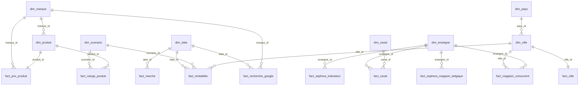

# Couche Gold – Modèle de données (constellation)

> Projet Sephora (LVMH) – Étude d'implantation aux Pays-Bas.
> Code : étape 2 (`construire_gold()`) de `scripts/etl_nettoyage_modele_etoile.py`. Exécution : `python scripts/etl_nettoyage_modele_etoile.py gold` (pandas requis ; lit `data/silver/`).

Le modèle répond à la question : **l'implantation de Sephora (catégorie maquillage) aux Pays-Bas est-elle réalisable et rentable ?** Il s'agit d'un **schéma en constellation** : plusieurs schémas en étoile (un par table de faits) partagent les mêmes dimensions, avec deux liens en flocon (produit → marque, ville → pays). Il comprend **8 dimensions** (tables descriptives, pour filtrer et regrouper) et **10 tables de faits** (mesures), chacune à un seul niveau de détail. Le script produit aussi **8 vues à plat**, prêtes à brancher dans un outil de dashboard, et lance **50 contrôles de qualité**.

## Sommaire

1. [Schéma](#1-schéma)
2. [Dimensions](#2-dimensions)
3. [Tables de faits](#3-tables-de-faits)
4. [Score de désirabilité](#4-score-de-désirabilité)
5. [Vues à plat pour le dashboard](#5-vues-à-plat-pour-le-dashboard)
6. [KPI et graphiques](#6-kpi-et-graphiques)
7. [Contrôles de qualité](#7-contrôles-de-qualité)
8. [Limites](#8-limites)

---

## 1. Schéma



**Type de modèle**

- **Constellation** (ou schéma en galaxie) : 10 tables de faits, chacune au centre de sa propre étoile, partagent les dimensions (`dim_date`, `dim_scenario`, `dim_ville`, `dim_enseigne`…). Un même filtre (par exemple le scénario) agit ainsi sur plusieurs tables de faits.
- **Deux liens en flocon** : `dim_produit` → `dim_marque` et `dim_ville` → `dim_pays`. Une dimension reliée à une autre dimension évite de répéter les informations de la marque dans chaque produit et celles du pays dans chaque ville.

Deux règles structurent le modèle :

- **un grain par table de faits** (un produit, une ville, une marque × une semaine…) ;
- **jamais de croisement produit × ville** : les produits et les villes sont analysés dans des tables de faits séparées, reliées par des dimensions partagées (scénario, date, enseigne).

## 2. Dimensions

| Table | Clé | Lignes | Contenu |
|---|---|---:|---|
| `dim_produit` | `produit_id` | 31 | Nom, marque, sous-catégorie (Teint, Yeux, Lèvres), type, rang sephora.fr, exclusif / partagé, LVMH, format mini |
| `dim_marque` | `marque_id` | 13 | Marque, groupe (LVMH, Marque tendance, Marque classique, Marque maison Sephora, Enseigne étudiée), score Google Trends 0-100 |
| `dim_ville` | `ville_id` | 4 | Ville, `ville_geo` (nom reconnu par les outils de cartographie), rue de référence du loyer |
| `dim_date` | `date_id` (AAAAMMJJ) | 66 | Date, année, trimestre, mois, semaine ISO |
| `dim_scenario` | `scenario_id` | 3 | Pessimiste / Central / Optimiste, avec **toutes les hypothèses** (part de marché visée, taux de marge, effectif, charges, transport, coût d'ouverture, surface, salaire) |
| `dim_enseigne` | `enseigne_id` | 4 | Sephora, Douglas, ICI Paris XL, De Bijenkorf ; groupe propriétaire, type d'enseigne |
| `dim_canal` | `canal_id` | 7 | Canal de distribution (drogueries, parfumeries, supermarchés…), magasin physique ou non |
| `dim_pays` | `pays_id` | 2 | France, Pays-Bas : TVA, droits de douane, devise, réglementation cosmétique |

Les faits annuels (marché, rentabilité, canaux, indicateurs Sephora) sont reliés au 1er janvier de leur année (`date_id` = AAAA0101).

## 3. Tables de faits

| Table | Grain | Lignes | Mesures principales | Axe |
|---|---|---:|---|---|
| `fact_prix_produit` | 1 produit | 31 | Prix France TTC/HT, prix Douglas et ICI Paris XL, indice de prix NL/FR, prix de vente Sephora NL (option C), note, avis, score de désirabilité | Prix, assortiment |
| `fact_marge_produit` | 1 produit × 1 scénario | 93 | Coût d'achat, marge brute (€), taux de marge (%) | Marges |
| `fact_recherche_google` | 1 marque × 1 semaine | 424 | Score Google Trends ; semaine du pic ; semaines d'ouverture des magasins Sephora en Belgique | Demande |
| `fact_ville` | 1 ville | 4 | Population, marché du maquillage de la ville, concurrents (par enseigne, pour 100 000 hab.), loyer (m² et 270 m²), distances | Implantation |
| `fact_magasin_concurrent` | 1 magasin | 130 | 1 magasin (comptage), coordonnées GPS (Douglas), ville cible ou non | Concurrence |
| `fact_rentabilite` | 1 ville × 1 scénario × 1 année | 36 | CA, marge, loyer, personnel, transport, résultat annuel et cumulé, point mort | Rentabilité |
| `fact_marche` | 1 année × 1 périmètre | 8 | Taille du marché (M€), croissance annuelle | Marché |
| `fact_canal` | 1 canal × 1 enseigne | 8 | Ventes 2020 (M€), part de marché (magasins physiques, marché total) | Marché |
| `fact_sephora_indicateur` | 1 indicateur | 14 | Chiffres actuels de Sephora (magasins, CA, parts de marché France, LVMH) | Situation actuelle |
| `fact_sephora_magasin_belgique` | 1 magasin | 5 | Magasins Sephora en Belgique : statut, date d'ouverture, surface | Situation actuelle |

**Formules des mesures calculées**

```text
prix_sephora_fr_ht          = prix_sephora_fr_ttc / 1,20
prix_concurrent_nl_min_ttc  = minimum (prix Douglas, prix ICI Paris XL)
indice_prix_nl_fr_ttc       = prix_concurrent_nl_min_ttc / prix_sephora_fr_ttc × 100       (produits partagés)
indice_prix_nl_fr_ht        = (prix_concurrent_nl_min_ttc / 1,21) / prix_sephora_fr_ht × 100
loyer_annuel_270m2_eur      = loyer_prime_m2_an_eur × 270
couts_fixes_eur             = loyer + personnel + transport
```

Les calculs de prix de vente, de marges et de rentabilité sont détaillés dans `docs/previsions/`.

## 4. Score de désirabilité

```text
Score de désirabilité = 0,40 × score Google Trends de la marque (0-100)
                      + 0,35 × score avis (note / 5 × 100)
                      + 0,25 × bonus exclusivité (100 si exclusif, sinon 0)
```

- **Échelle Google Trends** : 100 = la marque la plus recherchée (Rhode). Le terme « sephora » mesure surtout l'intérêt pour l'**enseigne** (ses pics coïncident avec les ouvertures de magasins en Belgique) : il est exclu de l'échelle des marques et n'est pas attribué aux produits Sephora Collection.
- **15 produits sans score** : leur marque n'est pas suivie dans Google Trends (Sephora Collection, Too Faced, Tarte, Benefit Cosmetics, Make Up For Ever). Aucune valeur n'est inventée.

## 5. Vues à plat pour le dashboard

Une vue à plat réunit dans un seul fichier les mesures d'une table de faits et les libellés de ses dimensions : elle se branche directement dans Looker Studio ou Tableau, sans jointure à configurer.

| Vue | Contenu | Graphiques |
|---|---|---|
| `vues/vue_kpi.csv` | 13 KPI calculés par le script (valeur, unité, axe, table source) | Cartes de KPI |
| `vues/vue_produits.csv` | 1 ligne par produit : prix, indice de prix, désirabilité, marque, sous-catégorie, exclusif / partagé | Prix, assortiment, désirabilité |
| `vues/vue_marges.csv` | 1 ligne par produit et scénario | Marges |
| `vues/vue_rentabilite.csv` | 1 ligne par ville, scénario et année, avec les hypothèses du scénario | Rentabilité, point mort |
| `vues/vue_recherches_google.csv` | 1 ligne par marque et semaine, avec date, mois et événements | Courbes de recherche |
| `vues/vue_villes.csv` | 1 ligne par ville | Comparaison des villes, carte |
| `vues/vue_magasins_concurrents.csv` | 1 ligne par magasin, avec enseigne et GPS | Carte des concurrents |
| `vues/vue_parts_de_marche.csv` | 1 ligne par canal ou enseigne | Camembert des parts de marché |

## 6. KPI et graphiques

**KPI** (valeurs calculées dans `vues/vue_kpi.csv`)

| Axe | KPI | Valeur |
|---|---|---:|
| Réalisable | Taille du marché du maquillage NL (2024) | 515 M€ |
| Réalisable | Croissance annuelle moyenne 2019-2024 | +6,5 %/an |
| Réalisable | Part de marché Douglas + ICI Paris XL (magasins physiques) | 21,4 % |
| Réalisable | Indice de prix NL / France (produits partagés) | 96,4 |
| Réalisable | Part de produits exclusifs | 54,8 % |
| Réalisable | Évolution des recherches « sephora » aux Pays-Bas | +46,3 % |
| Réalisable | Score de désirabilité : exclusifs / partagés | 72,0 / 56,3 |
| Rentable | Marge brute moyenne par produit (central) | 10,95 € (42,8 %) |
| Rentable | Combinaisons ville × scénario rentables en 2029 | 0 sur 12 |
| Rentable | Meilleur résultat annuel 2029 (La Haye, optimiste) | −231 005 € |
| Rentable | Part de marché minimale nécessaire au point mort | 8,7 % |

**Graphiques**

| # | Graphique | Vue | Message |
|---|---|---|---|
| 1 | Courbe du marché du maquillage 2019-2025 | `fact_marche` | Marché de plus de 500 M€, en croissance |
| 2 | Camembert des parts de marché (magasins physiques) | `vue_parts_de_marche` | Douglas + ICI Paris XL ≈ 21 % |
| 3 | Carte des magasins concurrents | `vue_magasins_concurrents` | Duopole très présent dans la Randstad |
| 4 | Barres : indice de prix par produit, exclusifs vs partagés | `vue_produits` | Sur les produits partagés, les concurrents NL sont moins chers |
| 5 | Courbes Google Trends (Sephora et marques), avec les ouvertures belges | `vue_recherches_google` | La demande existe et réagit aux ouvertures |
| 6 | Barres : résultat 2029 par ville et scénario, avec ligne à zéro | `vue_rentabilite` | Aucune ville rentable en 100 % maquillage |
| 7 | Barres : part de marché visée vs part de marché au point mort | `vue_rentabilite` | Le point mort est hors de portée d'un magasin |

Filtres utiles : scénario, ville, sous-catégorie, exclusif / partagé, groupe de marque.

## 7. Contrôles de qualité

Le script vérifie, à chaque exécution :

- **unicité des clés** des 8 dimensions ;
- **intégrité référentielle** : 24 liens entre tables, aucune clé orpheline ;
- **unicité du grain** des 10 tables de faits ;
- **cohérence des calculs** : résultat = marge − loyer − personnel − transport ; marge = prix NL HT − coût d'achat ; indice de prix renseigné seulement pour les produits partagés ; score de désirabilité entre 0 et 100 ; échelle Trends à 100 pour la première marque ;
- **cohérence entre tables** : nombre de magasins par ville identique entre `fact_ville` et `fact_magasin_concurrent` ; parts de marché par canal égales à 100 %.

Résultat attendu : `tous les contrôles sont OK` (50 contrôles).

## 8. Limites

- `fact_ville` et `fact_magasin_concurrent` ne couvrent pas les mêmes enseignes : De Bijenkorf est compté dans `nb_concurrents_total` mais n'a pas de liste de magasins. Pour comparer, utiliser `nb_douglas_ici`.
- `fact_magasin_concurrent` : Douglas couvre tout le pays (111 magasins, GPS), ICI Paris XL seulement les 4 villes cibles (19 magasins, sans GPS). Filtrer sur `is_ville_cible = 1` pour comparer les deux enseignes.
- `fact_canal` porte sur 2020 (dernière répartition par canal publiée en accès libre) ; les parts de Douglas et ICI Paris XL sont estimées (voir `docs/marche/parts_de_marche_douglas_ici_NL.md`).
- Score de désirabilité : 16 produits sur 31 ; les produits exclusifs notés sont surtout des marques tendance (Rhode, Makeup By Mario).
- Les hypothèses et limites des prévisions sont détaillées dans `docs/previsions/`.
