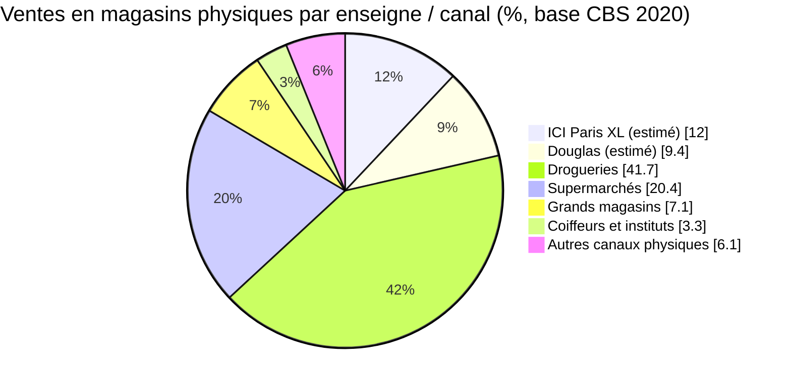
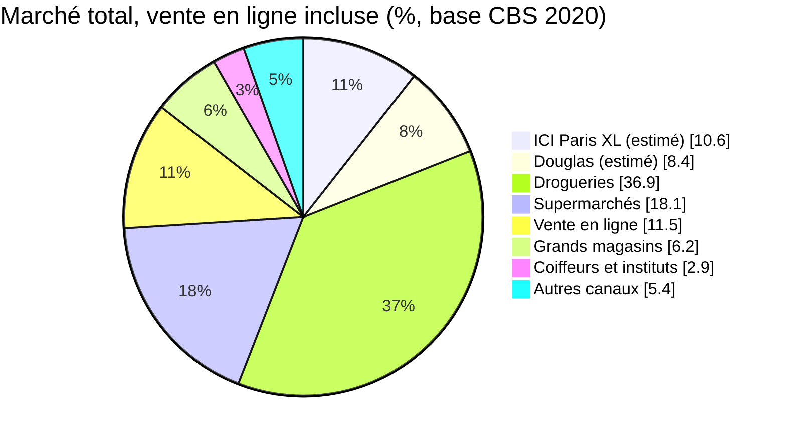

# Parts de marché de Douglas et ICI Paris XL aux Pays-Bas

> Projet Sephora (LVMH) – Étude d'implantation aux Pays-Bas.
> Recherche web réalisée et sources vérifiées le 12 novembre 2026.

Douglas et ICI Paris XL, les deux principales chaînes de parfumerie sélective aux Pays-Bas, représentent ensemble **environ 21 % des ventes de cosmétiques et parfums en magasins physiques** (ICI Paris XL ≈ 12,0 %, Douglas ≈ 9,4 %), et **environ 19 % du marché total** en incluant la vente en ligne. Pour le maquillage, cela correspond à **environ 98 M€**, dont **≈ 55 M€ pour ICI Paris XL** et **≈ 43 M€ pour Douglas**. Ces parts sont **estimées** : aucune des deux enseignes ne publie de chiffre d'affaires propre aux Pays-Bas (méthode en [section 3](#3-estimation-des-parts-de-marché--méthode)).

## Sommaire

1. [Répartition du marché par canal de distribution](#1-répartition-du-marché-par-canal-de-distribution)
2. [Douglas et ICI Paris XL : données publiées](#2-douglas-et-ici-paris-xl--données-publiées)
3. [Estimation des parts de marché : méthode](#3-estimation-des-parts-de-marché--méthode)
4. [Hypothèses et limites](#4-hypothèses-et-limites)
5. [Sources](#5-sources)

---

## 1. Répartition du marché par canal de distribution

Ventes de cosmétiques et parfums aux consommateurs aux Pays-Bas, par type de commerce (CBS, année 2020). Deux bases sont présentées :

- **Magasins physiques** (3 273 M€) : base de référence pour une implantation en magasins ;
- **Marché total** (3 700 M€) : magasins physiques + vente en ligne.

| Canal | Ventes (M€) | Part – magasins physiques | Part – marché total | Statut |
|---|---:|---:|---:|---|
| Drogueries (Kruidvat, Etos…) | 1 364 | 41,7 % | 36,9 % | Publié |
| Parfumeries et magasins de cosmétiques | 702 | 21,4 % | 19,0 % | Publié |
| – dont ICI Paris XL | ≈ 393 | ≈ 12,0 % | ≈ 10,6 % | Estimé (section 3) |
| – dont Douglas | ≈ 309 | ≈ 9,4 % | ≈ 8,4 % | Estimé (section 3) |
| Supermarchés | 669 | 20,4 % | 18,1 % | Publié |
| Grands magasins | 231 | 7,1 % | 6,2 % | Publié |
| Coiffeurs et instituts de beauté | 108 | 3,3 % | 2,9 % | Publié |
| Autres canaux physiques | 199 | 6,1 % | 5,4 % | Calculé (total − canaux listés) |
| Vente en ligne | 427 | – | 11,5 % | Publié |
| **Total** | | **3 273 M€ (100 %)** | **3 700 M€ (100 %)** | |





**Évolution du canal parfumerie :**

| Période | Évolution | Source |
|---|---|---|
| 2012 → 2016 | part du canal : 20 % → 21 % | CBS (2018) |
| 2020 | part du canal : 19,0 % | CBS (2022) |
| 2025 | ventes de cosmétiques en parfumerie : −5,7 % (drogueries : +5,5 % ; supermarchés : −2,3 %) | NCV (2026) |

## 2. Douglas et ICI Paris XL : données publiées

| Donnée | ICI Paris XL | Douglas | Source |
|---|---|---|---|
| Groupe | A.S. Watson | Douglas Group | Sites des groupes |
| Magasins aux Pays-Bas (nov. 2026) | 141 | 111 | Localisateurs iciparisxl.nl et douglas.nl, relevé du 12/11/2026 |
| Part du réseau du duo | 56 % | 44 % | Calculé |
| Chiffre d'affaires Pays-Bas publié | Non | Non : inclus dans le segment DACHNL (Allemagne, Autriche, Suisse, Pays-Bas, Belgique) | Douglas Group |
| Part du e-commerce dans les ventes | n.d. | ≈ 33 % (groupe, T1 2024/25) | Douglas Group |
| Poids du groupe propriétaire | A.S. Watson (Kruidvat, Trekpleister, ICI Paris XL, Pour Vous) : 22 % des « health and beauty specialists » néerlandais en 2025 | – | Euromonitor |

## 3. Estimation des parts de marché : méthode

### 3.1 Part combinée Douglas + ICI Paris XL

Douglas et ICI Paris XL sont les deux grandes chaînes du canal parfumerie. Leur part combinée est approchée par la part de ce canal.

```text
Magasins physiques : 702 / (3 700 − 427) = 702 / 3 273 = 21,4 %
Marché total       : 702 / 3 700                       = 19,0 %
```

### 3.2 Répartition entre les deux enseignes

La part combinée est répartie au prorata du nombre de magasins.

```text
                 Magasins physiques          Marché total
ICI Paris XL  =  21,4 % × 141 / 252 = 12,0 %   19,0 % × 141 / 252 = 10,6 %
Douglas       =  21,4 % × 111 / 252 =  9,4 %   19,0 % × 111 / 252 =  8,4 %
```

### 3.3 Application au marché du maquillage (515 M€ en 2024)

La valeur de 515 M€ inclut la vente en ligne : la part sur le marché total est donc appliquée.

```text
Douglas + ICI Paris XL = 515 × 19,0 % ≈ 98 M€
ICI Paris XL           = 515 × 10,6 % ≈ 55 M€
Douglas                = 515 ×  8,4 % ≈ 43 M€
```

La valeur de 515 M€ est issue de l'étude « Taille du marché du maquillage aux Pays-Bas » du même dossier.

## 4. Hypothèses et limites

| Hypothèse | Effet possible |
|---|---|
| La part du canal parfumerie est attribuée entièrement à Douglas et ICI Paris XL | Surestimation : le canal comprend aussi des parfumeries indépendantes et d'autres chaînes (Pour Vous…) |
| Les ventes en ligne de Douglas et ICI Paris XL sont classées par le CBS dans le canal « vente en ligne » | Sous-estimation sur le marché total ; sans effet sur la base magasins physiques |
| La part mesurée sur l'ensemble cosmétiques + parfums est appliquée au maquillage | Écart possible si le poids des parfumeries diffère sur le maquillage |
| Chiffre d'affaires moyen par magasin identique pour les deux enseignes | Écart possible selon la taille et l'emplacement des magasins |
| Base 2020, la plus récente publiée par canal en accès libre | Le canal parfumerie a reculé en 2025 (−5,7 %) : la part actuelle est probablement un peu plus faible |

Les parts exactes par enseigne figurent dans des études payantes (Euromonitor, GlobalData), non consultées.

## 5. Sources

- CBS, « Aanvullend onderzoek voor branchevereniging NCV – 2. Omzetniveaus » (2022), ventes 2020 par canal : https://www.cbs.nl/nl-nl/longread/aanvullende-statistische-diensten/2022/aanvullend-onderzoek-voor-branchevereniging-ncv/2-omzetniveaus
- CBS, rapport pour la NCV (2018), ventes 2012-2016 par canal : https://www.cbs.nl/-/media/_pdf/2018/32/ncv-09082018.pdf
- NCV, « Nederlandse cosmeticasector groeit licht in 2025: premium én value winnen » : https://www.ncv-cosmetica.nl/actueel/nederlandse-cosmeticasector-groeit-licht-2025-premium-en-value-winnen/
- Douglas Group, « DOUGLAS Group starts with solid growth into financial year 2024/25 » (13 février 2025) : https://douglas.group/en/newsroom/press-releases/douglas-group-starts-with-solid-growth-into-financial-year-202425
- Douglas Group, rapport annuel 2024/2025 : https://douglas.group/fileadmin/user_upload/DOUGLAS_Annual_Report_2024-2025_EN.pdf
- Euromonitor International, « Health and Beauty Specialists in the Netherlands » (résumé) : https://www.euromonitor.com/health-and-beauty-specialists-in-the-netherlands/report
- ICI Paris XL, liste des magasins : https://www.iciparisxl.nl/alle-winkels
- Douglas, localisateur de magasins : https://www.douglas.nl
